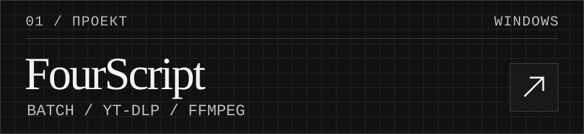
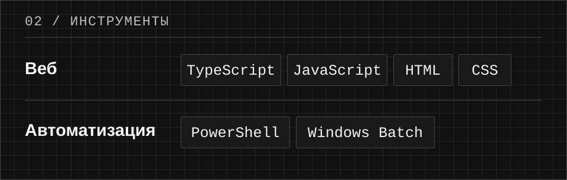

<picture>
  <source media="(prefers-color-scheme: dark)" srcset="assets/cover-dark.svg">
  <source media="(prefers-color-scheme: light)" srcset="assets/cover-light.svg">
  
</picture>

  <strong>Я вайбкодер.</strong> Делаю небольшие веб-проекты и пишу скрипты для задач, которые надоело делать вручную. Люблю, когда пользоваться результатом так же приятно, как смотреть на него.

 

<a href="https://github.com/plsfr/fourscript">
<picture>
  <source media="(prefers-color-scheme: dark)" srcset="assets/fourscript-dark.svg">
  <source media="(prefers-color-scheme: light)" srcset="assets/fourscript-light.svg">
  
</picture>
</a>

Скрипт для Windows, который скачивает видео с YouTube. Можно вставить одну ссылку или передать текстовый файл со списком.

 

<picture>
  <source media="(prefers-color-scheme: dark)" srcset="assets/tools-dark.svg">
  <source media="(prefers-color-scheme: light)" srcset="assets/tools-light.svg">
  
</picture>
