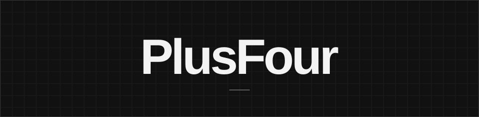

<picture>
  <source media="(prefers-color-scheme: dark)" srcset="assets/cover-dark.svg">
  <source media="(prefers-color-scheme: light)" srcset="assets/cover-light.svg">
  
</picture>

`01 / PROFILE`

I’m a **vibe coder**. I build small web projects and write scripts for tasks I’d rather automate. I care about how an interface looks and how it feels to use.

---

`02 / PROJECT`

### [FourScript](https://github.com/plsfr/fourscript)

A Windows script for downloading YouTube videos with yt-dlp. It accepts a single link or a plain-text list for batch downloads.

---

`03 / TOOLKIT`

**Web** &nbsp; `TypeScript` `JavaScript` `HTML` `CSS`  
**Automation** &nbsp; `PowerShell` `Windows Batch`
